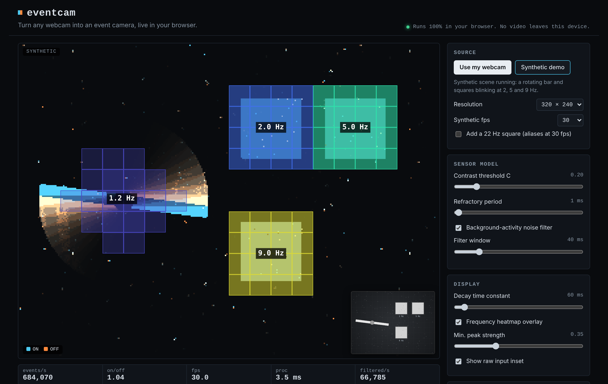

# eventcam

Turn any webcam into an event camera, live in your browser.

**Live demo: https://c-cheng10.github.io/eventcam-web/**



Event cameras don't capture frames. Each pixel reports on its own whenever its brightness changes, as a stream of
`(x, y, timestamp, polarity)` events. This page emulates one from ordinary webcam frames. It shows the event stream
live, finds periodic motion (flicker frequency) in each part of the image, and lets you record the events and
download them as data.

Everything runs client-side in plain HTML, CSS and JavaScript. There's no build step, no backend and no
dependencies, and video never leaves the browser. If you'd rather not share a camera, a synthetic scene with known
ground truth runs instead.

## How it works

1. **Frames in.** `getUserMedia` provides the webcam. Each frame is timed with `requestVideoFrameCallback` (or
   `requestAnimationFrame` where that's missing), centre-cropped to 4:3 and drawn into a small canvas: 320 × 240 by
   default, or 160 × 120 or 640 × 480.
2. **Log brightness.** Each pixel's luma `Y` becomes `L = ln(Y + 5)`, via a 256-entry lookup table.
3. **Threshold model.** Every pixel keeps a reference level. If `L − ref ≥ C` it emits one ON event per threshold
   crossing and moves `ref` up by `C` each time. OFF is the mirror image. A per-pixel refractory period limits how
   often a pixel can fire.
4. **Noise filter.** A background-activity filter drops an event when none of the 8 neighbouring pixels fired within
   the filter window (40 ms by default).
5. **Display.** ON and OFF events go into two decaying buffers drawn in two colours over a dark background.
6. **Periodic motion.** The image is split into 16 × 16 px cells. Each cell keeps a 3 s ring buffer of per-frame
   `ON − OFF` counts. Four times a second the detector integrates each active cell's series (which rebuilds the
   cell's log-brightness), removes the trend, applies a Hann window, zero-pads and runs a radix-2 FFT. The peak, refined
   by parabolic interpolation, gives the cell's frequency, and the share of power in the peak gives its strength.

The state lives in typed arrays: no per-pixel or per-event objects. At 320 × 240 a frame takes about 3 ms in
headless Chromium.

Using `ON − OFF`, not the total event count, is deliberate. A blinking light fires ON when it turns on and OFF when it
turns off, so the total count would read twice the real blink rate.

## Synthetic mode and tests

The synthetic scene renders at exact simulated times: a rotating two-armed bar plus squares blinking at 2, 5 and
9 Hz, with an optional 22 Hz square that aliases to 8 Hz at 30 fps. The tests run in headless Chromium with
Playwright and Chromium's fake camera:

```bash
npm test
```

- `tests/smoke.mjs`: synthetic mode and the fake camera both produce events at every resolution, with no console
  errors.
- `tests/frequency.mjs`: detected frequencies match the blinking squares within ±0.3 Hz at 30 and 60 fps, and the
  22 Hz square reads as 8 Hz at 30 fps.
- `tests/record.mjs`: a recording exports to CSV and binary, and the two files agree, are time ordered and match
  the sidecar.
- `tests/screenshot.mjs`: regenerates `docs/screenshot.png` and checks the layout at phone width.

To serve the page locally, run `npm run serve` and open http://127.0.0.1:8080. Browsers only allow camera access
over HTTPS or on localhost.

## Export format

Press **Record**, then **Stop**. Recording holds up to 5,000,000 events and stops by itself at that cap.

- **CSV**: header `x,y,t_us,p`, one event per line.
- **Binary `.bin`**: packed little-endian records of 9 bytes each: `uint32 t_us`, `uint16 x`, `uint16 y`,
  `int8 p`.
- **Sidecar `.json`**: resolution, contrast threshold `C`, refractory period, noise-filter settings, start time,
  event count and the NumPy dtype.

`t_us` counts microseconds from the start of the recording. `p` is `+1` for ON and `-1` for OFF. Events are in time
order.

Load a recording with NumPy:

```python
import json
import numpy as np

def load_events(bin_path, json_path):
    meta = json.load(open(json_path))
    dtype = np.dtype([(name, fmt) for name, fmt in meta["numpy_dtype"]])  # packed, 9 bytes
    events = np.fromfile(bin_path, dtype=dtype)
    return events, meta

ev, meta = load_events("eventcam.bin", "eventcam.json")
print(len(ev), "events over", ev["t_us"][-1] / 1e6, "s at", meta["width"], "x", meta["height"])
```

## Limitations

- **Frame rate sets the limit.** Events are computed from frames, so timing is only as good as the frame rate.
  Events inside one frame interval are spread over it in 16 time slots, not measured. Nothing faster than half the
  frame rate (15 Hz at 30 fps) can be measured, and faster flicker aliases to a false lower frequency. A real event
  camera has microsecond timing and can measure drone propellers at hundreds of hertz. This can't.
- **The webcam does its own processing.** Auto-exposure, auto white balance, compression and motion blur all change
  pixel values in ways a real event pixel never would. Turning the room lights on or off will produce a burst of
  events.
- **Not a calibrated sensor model.** There's no per-pixel threshold mismatch, no realistic noise model and no
  bandwidth limit.
- **Frequency estimation assumes evenly spaced frames.** Frame-rate jitter from a real camera will blur the
  peaks somewhat.
- **Tested with fakes only.** The automated tests use the synthetic scene and Chromium's fake camera. No physical
  webcam was used during development.

## Deploying

`.github/workflows/pages.yml` publishes the site on every push to `main`. It needs one repository setting:
**Settings → Pages → Build and deployment → Source: GitHub Actions**.

## License

MIT. See [LICENSE](LICENSE).
